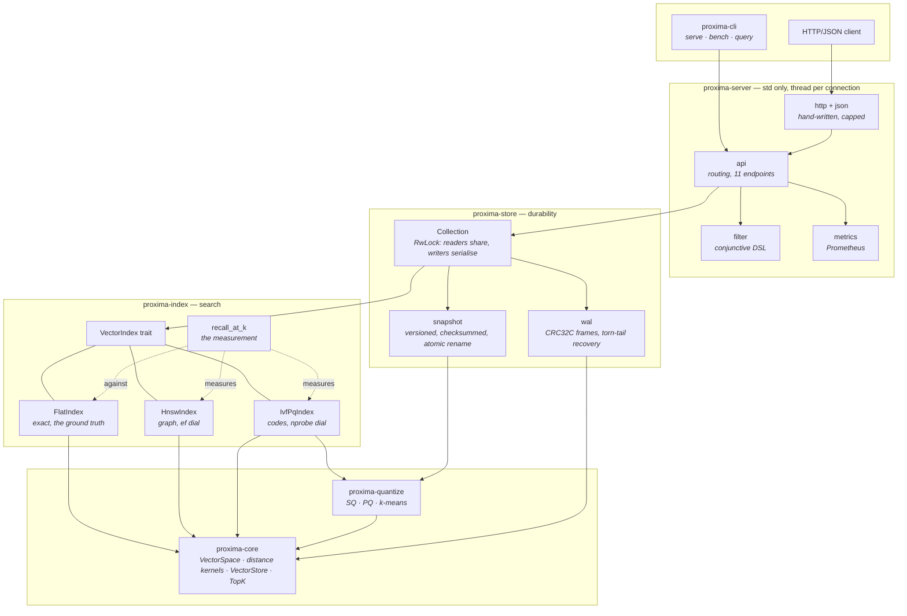

# Proxima

A vector search engine written from first principles in Rust, with the recall
number as part of the API rather than part of the marketing.

[](https://github.com/proxima-search/proxima/actions/workflows/ci.yml)
[](https://github.com/proxima-search/proxima/actions/workflows/audit.yml)
[](LICENSE)
[](rust-toolchain.toml)
[](#house-rules)
[](Cargo.toml)

The graph, the quantizers, the k-means, the distance kernels, the write-ahead
log, the HTTP server and the JSON parser are all in this repository. There is no
dependency on `faiss`, `hnswlib`, `usearch`, `ndarray`, `tokio`, `axum` or
`serde`. Four runtime dependencies in total: `thiserror`, `rand`, `rand_chacha`
and `signal-hook`, each justified by a paragraph in [`Cargo.toml`](Cargo.toml).

---

## 60-second quickstart

Two ways in. Both of them compile — the library one is
[`examples/quickstart.rs`](examples/quickstart.rs), which `make ci` builds and
runs, and the server one is a shell transcript from a real run.

### As a library

```rust
use proxima_core::{Metadata, Metric, VectorId};
use proxima_index::{recall_at_k, FlatIndex, HnswConfig, HnswIndex, VectorIndex};

fn main() -> Result<(), proxima_core::ProximaError> {
    // A graph index, and a flat one to measure it against.
    let space = proxima_core::VectorSpace::new(64, Metric::Cosine)?;
    let mut index = HnswIndex::new(space.clone(), HnswConfig::new().with_seed(42))?;
    let mut truth = FlatIndex::new(space);

    // 5 000 vectors with cluster structure, and every fiftieth one as a query.
    let mut queries = Vec::new();
    for id in 0..5_000u64 {
        let cluster = (id % 50) as f32;
        let vector: Vec<f32> = (0..64)
            .map(|d| (cluster * 0.7 + d as f32 * 0.11).sin() + id as f32 * 0.00002 * d as f32)
            .collect();
        let metadata = Metadata::new().with("lang", if id % 3 == 0 { "en" } else { "fr" });
        index.insert(VectorId::new(id), &vector, metadata.clone())?;
        truth.insert(VectorId::new(id), &vector, metadata)?;
        if id % 50 == 0 {
            queries.extend_from_slice(&vector);
        }
    }

    // Search, with a filter that runs *during* traversal, so `k` results really
    // are the `k` nearest accepted vectors and not the accepted ones it walked past.
    let english = |_id: VectorId, meta: &Metadata| meta.text("lang") == Some("en");
    let hits = index.search(&queries[..64], 10, &english)?;
    println!(
        "{} hits, nearest {} at {:.4}",
        hits.len(),
        hits[0].id,
        hits[0].distance
    );

    // And the number that makes the previous line mean something.
    let report = recall_at_k(&index, &truth, &queries, 10)?;
    println!("{report}");
    assert!(report.mean > 0.99, "{report}");
    Ok(())
}
```

```console
$ cargo run --release --example quickstart
10 hits, nearest 0 at 0.0000
recall@10: mean 1.0000, min 1.0000, below 0.9 0.0% (100 queries)
```

### As a server

```console
$ cargo build --release -p proxima-cli
$ ./target/release/proxima serve --data /tmp/proxima --address 127.0.0.1:7700 &
proxima 0.1.0 listening on http://127.0.0.1:7700
  data:  /tmp/proxima
  fsync: always
  collections: none yet
  shutdown: SIGTERM, SIGINT, or POST /admin/shutdown

$ curl -s -X POST localhost:7700/collections \
    -d '{"name":"docs","dim":4,"metric":"euclidean","index":{"type":"hnsw","m":16}}'
{"dim":4,"index":"hnsw","metric":"euclidean","name":"docs","sync_policy":"always"}

$ curl -s -X POST localhost:7700/collections/docs/points -d '{"points":[
    {"id":1,"vector":[1,0,0,0],"metadata":{"lang":"en","year":2024}},
    {"id":2,"vector":[0,1,0,0],"metadata":{"lang":"fr","year":2020}},
    {"id":3,"vector":[0.9,0.1,0,0],"metadata":{"lang":"en","year":2026}}]}'
{"upserted":3,"vectors":3}

$ curl -s -X POST localhost:7700/collections/docs/search \
    -d '{"vector":[1,0,0,0],"k":2,"filter":{"lang":"en","year":{"gte":2025}}}'
{"filtered":true,"results":[{"distance":0.141421377658844,"id":3,
"metadata":{"lang":"en","year":2026},"score":0.020000005140900612}],"took_micros":48}

$ curl -s localhost:7700/metrics | grep proxima_collection_vectors
# HELP proxima_collection_vectors Live vectors.
# TYPE proxima_collection_vectors gauge
proxima_collection_vectors{collection="docs",index="hnsw"} 3

$ curl -s -X POST localhost:7700/admin/shutdown
{"status":"shutting_down"}
proxima: stopped cleanly, write-ahead logs flushed
```

Every acknowledged write above is already on disk: the default sync policy
`fsync`s the write-ahead log before the request returns. Kill the process at any
point and reopening the collection reproduces exactly the same search results.

---

## Architecture



[`ARCHITECTURE.md`](ARCHITECTURE.md) has the algorithms; `docs/adr/` has the
decisions and what they cost.

## The crates

| crate | what it is | depends on | lines (tests included) |
|---|---|---|--:|
| [`proxima-core`](crates/proxima-core) | `VectorSpace`, the distance kernels and their unrolled variants, `VectorStore`, `SlotAllocator`, `TopK`, `Metadata`, one error enum | `thiserror` | 3 128 |
| [`proxima-quantize`](crates/proxima-quantize) | scalar quantization, product quantization, k-means with k-means++ seeding | core, `rand` | 2 165 |
| [`proxima-index`](crates/proxima-index) | the `VectorIndex` trait, `FlatIndex`, `HnswIndex`, `IvfPqIndex`, `recall_at_k` | core, quantize, `rand` | 5 192 |
| [`proxima-store`](crates/proxima-store) | write-ahead log, snapshots, `Collection`, the binary codec and CRC-32C | core, index, quantize | 4 359 |
| [`proxima-server`](crates/proxima-server) | HTTP/1.1 + JSON on `std`, the filter language, Prometheus metrics, graceful shutdown | store, `signal-hook` | 3 723 |
| [`proxima-cli`](crates/proxima-cli) | the `proxima` binary: `serve`, `bench`, `query` | all | 1 426 |

## Measured numbers

Everything below was measured on the machine described in
[`crates/proxima-index/BENCHMARKS.md`](crates/proxima-index/BENCHMARKS.md)
(aarch64, 4 cores, `--release` with fat LTO, single-threaded). Reproduce all of
it with one command:

```console
$ cargo run --release -p proxima-cli -- bench --vectors 50000 --dim 128
```

**50 000 vectors, dimension 128, 64 Gaussian clusters, 200 queries, `k = 10`.**

| index | build | mean query | p95 | bytes/vector | recall@10 | worst query |
|---|--:|--:|--:|--:|--:|--:|
| flat | 8.0 ms | 1 049 µs | 1.1 ms | 512 | 1.0000 | 1.00 |
| hnsw `M=16 ef=64` | 6.1 s | **52.6 µs** | 58.9 µs | 669 | 0.9990 | 0.90 |
| ivfpq `m=32 nprobe=16` | 26.0 s | 269 µs | 283 µs | 718 | 0.6400 | 0.30 |
| ivfpq + rerank 100 | 26.1 s | 308 µs | 340 µs | 718 | 0.9990 | 0.90 |
| ivfpq, vectors dropped | 26.2 s | 270 µs | 287 µs | **47** | 0.6400 | 0.30 |

The recall/latency dial, on one built graph:

| `ef_search` | 16 | 32 | 64 | 128 | 256 |
|---|--:|--:|--:|--:|--:|
| mean query | 24.5 µs | 37.2 µs | 53.0 µs | 70.9 µs | 98.2 µs |
| recall@10 | 0.9630 | 0.9925 | 0.9990 | 1.0000 | 1.0000 |
| worst query | 0.00 | 0.70 | 0.90 | 1.00 | 1.00 |

Read the *worst query* row, not the mean. At `ef = 16` the mean is a respectable
0.963 and one query in two hundred returns **nothing** correct.
`RecallReport` reports the minimum and the below-threshold fraction for exactly
this reason.

**Distance kernels**, from `cargo bench -p proxima-core`. The unrolled variants
break the loop-carried dependency on the accumulator, which is what lets LLVM
emit NEON — 20 lines of ordinary safe Rust and the single largest optimisation
in the repository:

| kernel, dimension 768 | scalar | unrolled | speedup |
|---|--:|--:|--:|
| squared euclidean | 349.9 ns | 115.9 ns | 3.0x |
| dot | 328.3 ns | 45.1 ns | **7.3x** |
| cosine | 449.8 ns | 76.7 ns | 5.9x |

**Durability**, from `cargo run --release -p proxima-store --example fsync_cost`:

| sync policy | per record | survives power loss |
|---|--:|---|
| `always` (default) | 570-690 µs | everything acknowledged |
| `every_64` | 23-25 µs | all but the last 63 records |
| `never` | 1.8 µs | nothing promised |
| batch of 1 000 under `always` | 2.8-3.0 µs | everything acknowledged |

The last row is why the HTTP API has no single-point upsert: batching is a 200x
speedup that costs no durability at all, and an endpoint that looks more
convenient while being 200x slower is a trap.

## What this is not

This section is longer than the feature list on purpose. Everything here is a
real limitation of the code as it stands, not a roadmap item phrased carefully.

* **Single node. No replication, no sharding, no consensus.** One process, one
  disk, one copy of the data. If the machine dies, the data is on that machine's
  disk and nowhere else. There is no leader election, no read replica and no
  story for a corpus larger than one machine's RAM.
* **No ACID transactions.** A batch upsert is one `fsync`, not one atomic unit: a
  crash mid-batch leaves a *prefix* of it durable and replay applies that prefix.
  There is no isolation level, no rollback and no multi-collection atomicity.
  What is guaranteed is prefix consistency — whatever a recovered collection
  contains is the state some prefix of the acknowledged operations would have
  produced — and `crates/proxima-store/tests/recovery.rs` asserts it by
  truncating a real log at every byte offset.
* **No authentication, no authorisation, no TLS, no rate limiting.**
  `proxima serve` binds to `127.0.0.1` by default and must not be exposed to an
  untrusted network. Put a reverse proxy in front of it. See
  [`SECURITY.md`](SECURITY.md).
* **No OPQ, and the PQ recall on the current fixture is 0.64.** Bare IVF-PQ at
  `m = 32` reaches recall@10 of **0.6400**, and it does not improve with more
  probing — at `nprobe = nlist`, where every code in the corpus is scored, it is
  still 0.6400. The missing 36 % is inside the quantization error, not in a list
  the search missed. Two things about that figure:
  - The fixture is hostile to PQ by construction. Isotropic Gaussian clusters in
    128 dimensions have no low-dimensional structure for a subspace codebook to
    exploit. Real embeddings do, and published PQ recall on SIFT or GloVe at 16x
    compression is much higher. **The 0.64 does not transfer; the shape does.**
  - **Optimised Product Quantization is not implemented.** A learned rotation
    before quantization is the standard fix for exactly the inter-dimension
    correlation this fixture does not have — so implementing OPQ here would
    produce a measurement of nothing, and it was left out rather than added and
    reported against a fixture that cannot show it working.
* **You cannot have both the IVF-PQ memory saving and its recall.** Exact
  reranking takes recall from 0.6400 to 0.9990, and it needs the full-precision
  vectors, which is the memory the index was compressing away. The 47 bytes per
  vector row and the 0.9990 recall row are different rows.
  `IvfPqConfig::validate` refuses the combination rather than letting it look
  available. Reranking against *on-disk* vectors — the usual production answer,
  trading memory for one random read per candidate — is not implemented.
* **Filtered search has a latency cliff.** Filters are evaluated during graph
  traversal, which is a correctness requirement, not an optimisation:
  post-filtering a `k`-element result list returns fewer than `k` whenever the
  filter rejects anything. The cost is that a highly selective filter forces the
  search to escalate `ef` geometrically to `filter_ef_limit` (1 024 by default),
  and below roughly 1-in-`ef` selectivity it falls back to an **exhaustive
  scan** — `O(n)`, the same as no index at all. That is the right algorithm at
  that selectivity and it is a cliff, not a slope: at 1-in-40 on a 10 000-vector
  corpus the fallback fires and recall stays at 1.0000; without it, recall is
  0.3880. You can turn the fallback off with
  `HnswConfig::with_exhaustive_filter_fallback(false)`, which chooses short
  results over slow ones, explicitly.
* **No parallel index build.** Building 50 000 vectors takes 6.1 s on one core
  and would take about 1.6 s on four. It is deliberately not parallelised:
  concurrent inserts finish in a nondeterministic order, which changes the order
  neighbours are selected in and therefore the graph, and `HnswConfig::seed`
  would become a lie. "Same seed, same insertion order, same graph" is what the
  snapshot round-trip tests and every reproducible benchmark rest on, and it was
  judged worth more than build throughput. See
  [`docs/adr/0003-determinism-over-parallel-build.md`](docs/adr/0003-determinism-over-parallel-build.md).
* **Writers block readers.** One `RwLock` per collection. Searches are
  concurrent; a batch upsert of ten thousand vectors holds the write lock for
  about a second and every search arriving in that second waits. The mitigation
  that is not implemented is a copy-on-write index behind an atomic swap, which
  would double the memory.
* **No SIMD intrinsics.** Every kernel is portable safe Rust that the
  autovectoriser happens to compile well. Hand-written NEON or AVX-512 would
  plausibly gain another 1.5-2x, at the cost of `unsafe` and a per-architecture
  code path.
* **No HTTP/2, no chunked request bodies, no compression, no histogram metrics.**
  The server speaks the subset of HTTP/1.1 a JSON API needs. `/metrics` exports
  counters and gauges, so you can compute a mean search latency and not a p99.
* **Everything is in memory.** There is no memory-mapped index, no paging and no
  tiered storage. A collection's whole vector array and index structure are
  resident; the snapshot is a checkpoint, not a working set.

## How to read this codebase

Five files, in this order. They are the argument, and the rest is consequence.

1. **[`crates/proxima-core/src/space.rs`](crates/proxima-core/src/space.rs)** —
   80 lines that decide the shape of everything else. `VectorSpace::prepare`
   makes the cosine trap structural instead of conventional: an unnormalised
   query against a normalised corpus returns *plausible wrong answers*, and no
   test that does not measure recall will notice.
2. **[`crates/proxima-core/src/storage.rs`](crates/proxima-core/src/storage.rs)** —
   why the vectors live in one flat `Vec<f32>` addressed by slot, and why a
   `Vec<Vec<f32>>` would put two dependent cache misses in front of every
   distance evaluation in a graph search. Also the `detach`/`release` split,
   which is the reason a graph index can have tombstones at all.
3. **[`crates/proxima-index/src/hnsw.rs`](crates/proxima-index/src/hnsw.rs)** —
   the graph. Read `select_neighbours` for the diversity heuristic and
   `search_prepared` for the filtered-search argument: filling `k` results is
   not enough, the traversal must have *seen* `ef` accepted nodes, and the
   comment explains what happens when it has not.
4. **[`crates/proxima-index/src/recall.rs`](crates/proxima-index/src/recall.rs)** —
   the crate's actual headline. An approximate index without a recall number is
   a claim with no content; this is a function you call on your own corpus in
   three lines, in your own test suite, so that "we think recall is fine" becomes
   an assertion that fails when it stops being true.
5. **[`crates/proxima-store/src/wal.rs`](crates/proxima-store/src/wal.rs)** —
   what makes it a system rather than a library. The record framing, the
   torn-tail argument (stop at the *first* bad record, never scan past it), and
   an honest table of what `fsync` costs.

## House rules

Enforced by `make ci`, which is the same thing CI runs:

* `#![forbid(unsafe_code)]` in every crate, plus `unsafe_code = "deny"` at the
  workspace level. There are no exceptions.
* `///` documentation on every public item; `RUSTDOCFLAGS=-D warnings` in CI.
* No `unwrap` or `expect` outside tests. `clippy::unwrap_used` is `deny`, and
  test modules opt out with a module-level `#![allow]`, which makes every
  exception greppable in one command.
* Clippy pedantic, `-D warnings`. The lints that are switched off are switched
  off in [`Cargo.toml`](Cargo.toml) with a reason each.
* Comments explain **why**, state the trade-off and say what it cost.
* Every number in the documentation is one that was measured, by a command that
  is written down next to it.

```console
$ make ci     # fmt, clippy -D warnings, test, doc -D warnings, bench --no-run
```

## Licence

Apache 2.0. See [`LICENSE`](LICENSE) and [`NOTICE`](NOTICE).
